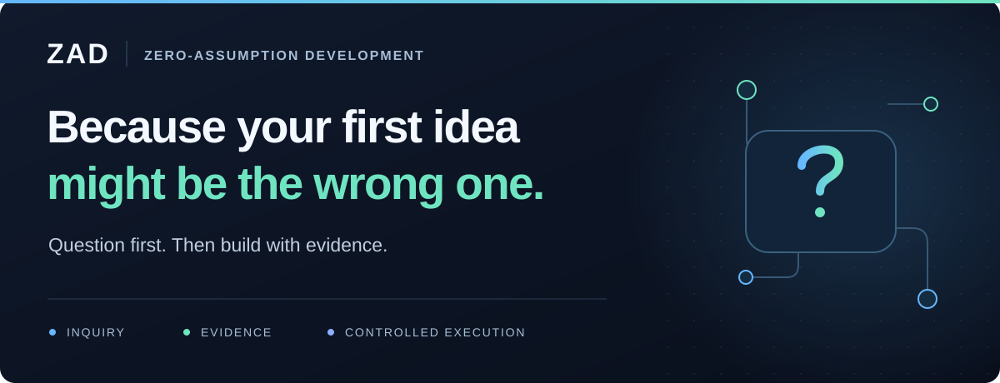

<p align="center">
  
</p>

<h1 align="center">Zero-Assumption Development (ZAD)</h1>

<p align="center">
  An AI-assisted development methodology focused on <strong>inquiry, evidence, and controlled execution.</strong>
</p>

<p align="center">
  <a href="#quickstart">Quickstart</a> ·
  <a href="#the-idea">The idea</a> ·
  <a href="#zad-in-practice">Examples</a> ·
  <a href="ZAD.md">Working agreement</a> ·
  <a href="https://skills.sh/marcel-silva/zero-assumption-development/zad">Skills.sh</a> ·
  <a href="#contribute">Contribute</a>
</p>

<p align="center">
  <strong>Methodology 1.0.0</strong> &nbsp;·&nbsp;
  <a href="LICENSE">MIT licence</a> &nbsp;·&nbsp;
  <a href="skills/zad/SKILL.md">Installable agent skill</a>
</p>

---

## Quickstart

Run this from your project folder and choose your coding assistant:

```sh
npx skills add marcel-silva/zero-assumption-development --skill zad
```

Then give it a task:

> Can you use ZAD to investigate this task before choosing a solution, and ask me only about important decisions the available evidence cannot resolve?

Include the problem, relevant context, and what you want the assistant to do. An investigation question is not permission to edit files or deploy changes.

The [skill](skills/zad/SKILL.md) is self-contained. You do not need to clone this repository to use it. See the [Skills CLI documentation](https://skills.sh/docs/cli) for installation options.

<details>
<summary><strong>Other ways to use ZAD</strong></summary>

**Across projects:** add `--global` to the installation command for user-scope installation.

**Without the installer:** copy [ZAD.md](ZAD.md) into your project and attach it to your coding assistant. Keep your existing instructions.

**As a standing project rule:** use the [integration guide](docs/TOOL_INTEGRATIONS.md). Installing a skill does not, by itself, make it active for every task.

</details>

## The idea

**Question first. Then build with evidence.**

ZAD wants you to ask before you commit to a solution.

Start every task assuming you (and the AI) don’t understand it yet.

Because when you ask your coding assistant:

> "Add caching to this endpoint."

You’ve already decided what the problem needs. The AI is now working on your answer, not investigating your problem.

Instead, try asking:

> Why is this endpoint slow, and what evidence would tell us whether caching is the right fix?

This way, caching is still an option. You just haven’t asked AI to commit to it before looking.

That is the habit behind Zero-Assumption Development. Start with what you need to understand, rather than what you want the AI to implement.

Ask about the problem, establish what supports your answer, and make changes within the agreed scope.

**You don't have to investigate everything. Focus on the questions whose answers could change the solution.**

## ZAD in practice

The change starts with how you frame the task. These examples illustrate the workflow; they are not measured performance comparisons.

| Starting with a solution | Starting with a question |
| --- | --- |
| Add caching to this endpoint. | Why is it slow, and what evidence would tell us whether caching is the right fix? |
| Rewrite this service. | What is making this service difficult to change, and could a smaller refactor address it? |
| Replace this dependency. | What problem does replacing it solve, and which existing behaviour do we need to preserve? |
| Fix this by adding a retry. | Why is the operation failing, and would retrying be safe? |

### From investigation to implementation

**First, an investigation question only:**

> What is causing this pagination bug, which evidence supports the diagnosis, and what is the smallest fix you would recommend without changing files yet?

**Then, with the evidence in hand, an implementation question to authorise:**

> Can you implement the selected pagination fix, preserve the public API, add regression tests, and report what you actually verified?

The first question requests an answer. The second authorises a scoped implementation. Neither authorises a production deployment.

See the [worked examples](examples/WORKED_EXAMPLES.md) and [prompt library](examples/PROMPT_LIBRARY.md) for more situations.

## Three pillars

<table>
  <tr>
    <td width="33%" valign="top">
      <h3>01 · Inquiry</h3>
      <p>Understand the problem before defending a solution.</p>
      <p>Ask what is failing, which constraints matter, and what you might be taking for granted.</p>
    </td>
    <td width="33%" valign="top">
      <h3>02 · Evidence</h3>
      <p>Check what supports the answer.</p>
      <p>Use code, requirements, documentation, tests, and measurements. Distinguish findings from assumptions.</p>
    </td>
    <td width="34%" valign="top">
      <h3>03 · Controlled execution</h3>
      <p>Make the change you have authority to make.</p>
      <p>Explain consequential decisions, stay within scope, and report what was actually verified.</p>
    </td>
  </tr>
</table>

## How the work moves forward

<p align="center">
  <strong>Discovery → Investigation → Design → Implementation → Validation</strong>
</p>

These are checkpoints, not five mandatory meetings or five separate prompts. A small, clear fix can pass through the cycle in one interaction. A consequential design decision may need several.

Every developer task prompt is a question. The AI responds normally: it investigates, explains, recommends, and implements when clearly authorised.

| Situation | What the assistant should do |
| --- | --- |
| The answer is in the codebase. | Investigate it rather than ask you to look it up. |
| A routine detail is within the agreed scope. | Make the decision and continue. |
| An important choice cannot be resolved from the available evidence. | Ask a targeted question and explain why the answer matters. |
| A consequential change is ready to implement. | Explain the evidence, trade-offs, and scope; proceed when authorised. |
| The implementation is complete. | Report the changes, actual checks, results, and remaining uncertainty. |

## When to use it

Use ZAD when a proposed solution deserves checking: a bug with an uncertain cause, a feature with missing requirements, a refactor in unfamiliar code, or a design decision with consequences beyond one file.

It does not need to become a ceremony. A clear, low-risk change should stay a clear, low-risk change. **Questioning can slow simple tasks.**

ZAD can sit alongside specifications, test-first development, and your existing engineering practices. It does not require replacing them.

## What is in this repository?

ZAD is a written working agreement and an installable skill, not a new coding agent. The toolkit gives you instructions, examples, and a way to evaluate the approach.

| Start with | Resources |
| --- | --- |
| **The method** | [Working agreement](ZAD.md) · [Manifesto](MANIFESTO.md) |
| **Setup** | [Installable skill](skills/zad/SKILL.md) · [Getting started](docs/GETTING_STARTED.md) · [Integration guide](docs/TOOL_INTEGRATIONS.md) |
| **Examples** | [Prompt library](examples/PROMPT_LIBRARY.md) · [Worked examples](examples/WORKED_EXAMPLES.md) · [Demo files](demo/) |
| **Your own tasks** | [Task template](templates/TASK.md) · [Experience report](templates/CASE_STUDY.md) |
| **Evaluation** | [Comparison protocol](evaluation/PROTOCOL.md) · [Validation notes](docs/VALIDATION.md) |
| **Contributing** | [Contribution guide](CONTRIBUTING.md) · [Roadmap](ROADMAP.md) · [Launch plan](docs/LAUNCH_PLAN.md) |

### Try the code demonstration

The repository includes a small pagination defect, a reference correction, and shared tests. With Git and Python 3.10 or newer installed:

```sh
git clone https://github.com/marcel-silva/zero-assumption-development.git
cd zero-assumption-development
python scripts/RunDemoV2.py
```

The runner expects the defective starter to fail and the reference to pass. It does not call an AI provider or require third-party Python packages.

**This checks the example code, not whether ZAD improves AI performance.** No controlled comparative study is included. The [evaluation protocol](evaluation/PROTOCOL.md) sets out how to test the question wording separately from the wider workflow.

## FAQ

<details>
<summary><strong>Does “zero-assumption” mean ignoring what we already know?</strong></summary>

No. Use your experience, existing requirements, documentation, and previous decisions. The point is not to treat unchecked assumptions as facts. Focus on uncertainty that could change the solution.

</details>

<details>
<summary><strong>Does every sentence have to be a question?</strong></summary>

Developer task prompts are questions ending in `?`. Supporting code, logs, examples, and documents do not need to be rewritten. The AI responds normally.

A question mark alone does not deliver the method. “Could you add caching?” can carry exactly the same unchecked assumption as “Add caching.”

</details>

<details>
<summary><strong>Will the AI keep asking me for approval?</strong></summary>

It should not. The agreement tells it to investigate available context first and make routine decisions within the authorised scope. It should ask when an important decision cannot safely be made from the information available.

</details>

<details>
<summary><strong>Does it make development faster or AI more accurate?</strong></summary>

That has not been established by this project. Questions can still be vague or leading. The AI can still be wrong. Tests, review, and permission controls still matter.

</details>

<details>
<summary><strong>Does installing ZAD enforce these rules?</strong></summary>

No. It supplies instructions to your assistant; it does not enforce permissions or create a security boundary. Installing the skill also does not guarantee that it is active in every task. Keep technical controls enabled and check how your assistant loads its instructions.

</details>

More questions are covered in the [full FAQ](docs/FAQ.md).

## What comes next

The next step is evidence from real use: where a question changed the solution, where the AI missed an assumption, and where the process added work without helping.

After that, the priority is a controlled comparison of the workflow. Further tooling should follow an observed need, not come first. See the [roadmap](ROADMAP.md) for the proposed priorities.

## Contribute

Try ZAD on one task and tell us what happened. Did a question change the solution? Did the AI find something you had overlooked? Did it ask too much and slow you down?

Use the [experience-report issue template](https://github.com/marcel-silva/zero-assumption-development/issues/new?template=experience_report.md) or the [case-study template](templates/CASE_STUDY.md). Reports where the approach added no value are useful too.

For changes to the method or toolkit, start with the [contribution guide](CONTRIBUTING.md).

## Licence

[MIT](LICENSE). The licence covers this toolkit. It does not change the licence of a project where you use it.

---

<p align="center">
  Proposed by <a href="https://github.com/marcel-silva">Marcel Silva</a> · Methodology version 1.0.0.<br>
  This repository defines a proposed workflow; it does not claim to have invented inquiry-based development.
</p>
